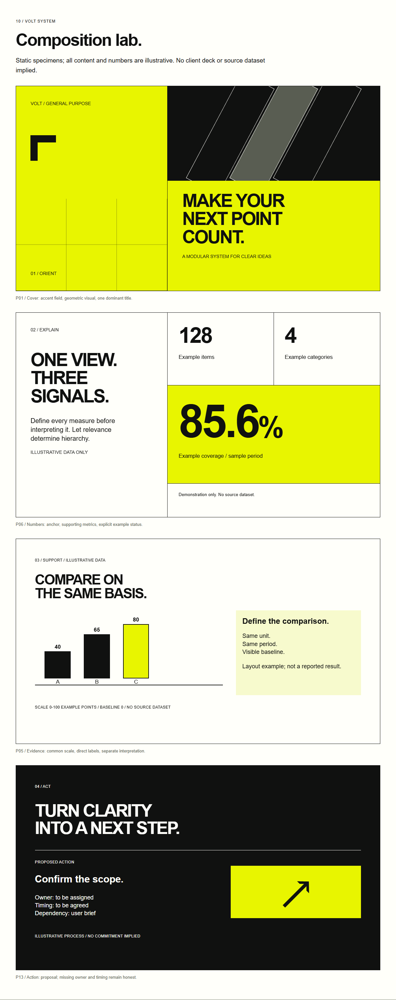

# VOLT Design System

Bold, modular, general-purpose presentation language. User context determines purpose and narrative.

## Start
Open index.html in a browser. Works offline, no scripts, remote fonts or image downloads. AI tools should read full HTML source plus companions; a repo URL alone does not guarantee every file was read.

Reading order: README → index.html (15 sections) → tokens.json → AI-INSTRUCTIONS.md → STORYTELLING.md → VALIDATION.md.

## Files
- index.html: complete rules, 14 components, 14 patterns, 7 image contracts, 8 shape rules, four composition specimens, embedded tokens.
- tokens.json: slide/web values with explicit units.
- AI-INSTRUCTIONS.md: execution contract and reusable prompt.
- STORYTELLING.md: English/Indonesian guidance.
- contrast-report.json: measured approved text pairs.
- VALIDATION.md: checks and limits.
- CHANGELOG.md: version history.
- volt-design-system.zip: portable package.

## Prompt
Read VOLT completely. Create [output] for [audience] to [purpose/outcome] using [sources, period, cutoff]. Language [language], mode [Read/Present], constraints [brand/scope]. Verify claims, flag critical gaps, apply VOLT and inspect final output.

## Scope / rights
Documentation/previews only; no client deck, PDF deck, editable master or dashboard application. VOLT is provisional; no trademark clearance performed. Third-party logos/photos/fonts not redistributed. No open-source license assigned automatically; choose one before granting public reuse rights. Repository: https://github.com/imragsn/volt-design-system .

Reference: Pitch Deck Presentation - Digits by Odama, https://dribbble.com/shots/25873606-Pitch-Deck-Presentation-Digits . Numerical specifications and open-corner motif are VOLT implementation decisions.
